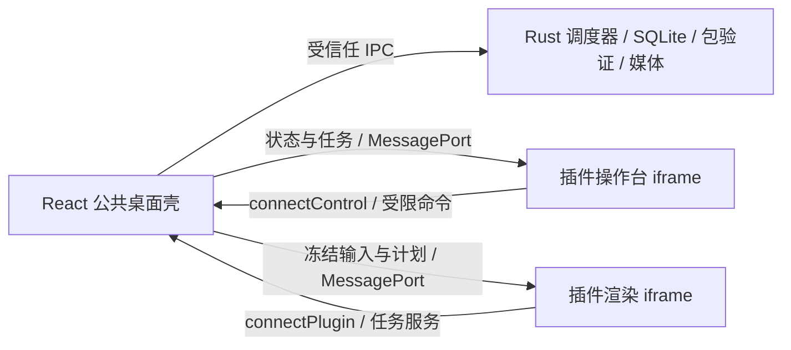

# liveboom 插件开发指南

本文面向玩法作者和定制交付团队，以当前代码为准：宿主 **0.2.3**、`@liveboom/plugin-sdk` **0.2.3**、`sdkApi: "1"`、包格式 `liveboom.plugin.v1`。项目未上线，仅维护当前协议，不承诺旧插件或旧数据库兼容。

## 文档导航

| 文档 | 内容 |
| --- | --- |
| 本文 | 架构边界、从零创建 React 玩法、专用工作台、目录组织 |
| [插件 API 参考](plugin-api-reference.md) | Manifest、Schema、生命周期、服务、控制台命令、资源限制 |
| [插件测试与交付](plugin-testing-and-release.md) | 调试、签名、离线安装、升级、回退、验收和故障排查 |
| [3D 制作台](printer-3d.md) | 复杂示例的功能与使用说明 |
| [开发数据目录与重置](development-data-reset.md) | 开发数据库路径与备份，非插件日常安装步骤 |

实现依据：[SDK](../packages/plugin-sdk/src/)、[打包器](../packages/plugin-sdk/bin/pack.mjs)、[Rust 插件验证器](../crates/play-runtime/src/plugins.rs)、[调度器](../crates/play-runtime/src/coordinator.rs)、[操作台桥](../packages/desktop-ui/src/PluginControlHost.tsx)。文档中的命令需在注明的仓库根目录执行；示例使用 POSIX shell，Windows 可在 PowerShell 中执行等价命令。

## 1. 架构与职责

一个插件是可离线安装的 `.lbplug` 文件。公共服务运行在本机 Tauri/Rust 进程中，不要求插件作者部署服务器。宿主与玩法源码独立，客户获得安装包及公开 SDK，无需获得私有仓库访问权限。



只有一个原生 `control` 窗口、一个权威队列、一个活动渲染实例和一份宿主音频输出。实际画面嵌入工作台，不再创建独立展示窗口。代码里的 `display_ready`、`register_display` 是渲染实例状态，不是系统窗口。

| 公共宿主负责 | 插件负责 |
| --- | --- |
| 包安装、签名、发布者信任、摘要校验 | 玩法规则、视觉、动画、专属操作界面 |
| 任务身份、幂等、队列、暂停、历史和重试 | 输入规整、冻结计划生成、执行及逐份完成回报 |
| Schema 校验、权限、资源和数据隔离 | 声明 Schema、按服务契约读写自身状态 |
| 媒体导入、原生保存对话框、声音播放 | 提供自有素材、字幕、声音请求、待导出图片 |

插件不得直接调用 Tauri、宿主 DOM、文件系统、SQL、子进程或任意网络服务。当前只接收 `manual` 和 `demo` 两种本地来源；平台抓包、支付、平台数据采集和官方平台接入不属于插件 SDK 能力。

插件文档运行在 `sandbox="allow-scripts"` 的不透明源 iframe 中。控制台和渲染文档互不读取 DOM，通信经过宿主。`DesktopTransport` 是公共壳的适配接口，不是供第三方玩法直接调用的 native 接口。

## 2. 选择开发形态与仓库结构

| 形态 | 适用情况 | 交付物 |
| --- | --- | --- |
| 渲染文档 + 宿主通用表单 | 快速验证玩法，输入字段较少 | `entry`、输入/配置 Schema |
| React 操作台 + 渲染文档 | 需要队列、属性、专属工具、复杂布局 | 另提供 `controlEntry` 和两项 control 能力 |
| 持久场景会话 + 每任务生命周期 | Three.js 场景、镜头、缓存、长驻资源 | 可选 `session.v1`、计划和显示设置能力 |

React 可以同时用于操作台和渲染文档；纯 Canvas/DOM 渲染也可以使用同一个协议。插件必须把自身依赖打进包内，不能使用宿主已有的 React 实例或 CDN。

建议私有仓库一仓一玩法：

```text
customer-play/
  package.json
  pnpm-lock.yaml
  vendor/liveboom-plugin-sdk-0.2.3.tgz
  manifest.json
  schemas/
    input.json
    config.json
    plan.json                 # 可选
    presentation.json         # 可选
    examples.json             # 可选
  src/
    display.tsx               # 渲染入口，接 connectPlugin
    control/App.tsx           # 可选操作台，接 connectControl
    control/style.css
    domain/                   # 纯规则与计划生成
    scene/                    # 图形资源、场景生命周期
  assets/                     # 仅随包交付的素材
  web/                        # 生成的自包含 HTML
  tests/
  build.mjs
  THIRD_PARTY_NOTICES
  dist/                       # 生成的 lbplug 和公钥信息
```

私钥放在仓库外或 CI secrets。私有玩法不要 import `packages/desktop-ui`、`apps/desktop`、Rust 宿主内部模块，也不要通过宿主客户分支实现定制。SDK 当前没有单独发布 npm 的保证，以下流程使用实际 tarball。

## 3. 从零创建可安装的 React 玩法

本节实现一个带暂停/继续的昵称显示玩法，操作区先用宿主通用表单。所有下面标明路径的代码块均为对应文件的完整内容。React 专用操作台在下一节增加。

### 3.1 准备工具与 SDK

开发插件只需 Node.js 22、pnpm 11 和前端构建依赖；只有构建或运行宿主时才需要 Rust/Tauri 原生环境。宿主环境见 [README](../README.md#开发)。

在公共 live-boom 仓库根目录执行：

```sh
mkdir -p /tmp/liveboom-sdk
pnpm --filter @liveboom/plugin-sdk pack --pack-destination /tmp/liveboom-sdk
```

生成 `/tmp/liveboom-sdk/liveboom-plugin-sdk-0.2.3.tgz`。在自己的独立仓库创建 `vendor/`，把该文件复制进去，然后写入下列文件。团队应保留 SDK 来源、版本、tarball SHA-256 和锁文件。

`package.json`：

```json
{
  "name": "customer-name-wall",
  "version": "1.0.0",
  "private": true,
  "type": "module",
  "license": "UNLICENSED",
  "scripts": { "build": "node build.mjs" },
  "dependencies": {
    "@liveboom/plugin-sdk": "file:vendor/liveboom-plugin-sdk-0.2.3.tgz",
    "react": "19.3.1",
    "react-dom": "19.3.1"
  },
  "devDependencies": { "esbuild": "0.28.2" }
}
```

这里采用当前仓库锁文件中的版本作为固定起点。独立仓库还需创建 `pnpm-workspace.yaml`，明确允许 esbuild 的安装构建脚本：

```yaml
allowBuilds:
  esbuild: true
```

然后在插件仓库执行 `pnpm install`，提交 `pnpm-lock.yaml` 与上述配置。否则 pnpm 11 可能以 `ERR_PNPM_IGNORED_BUILDS` 拒绝完成安装。不要为解决这一错误全局允许所有依赖执行安装脚本。

### 3.2 Manifest 与 Schema

`manifest.json`：

```json
{
  "id": "customer.name-wall",
  "name": "昵称展示墙",
  "version": "1.0.0",
  "sdkApi": "1",
  "hostVersion": ">=0.2.3 <0.3.0",
  "entry": "web/index.html",
  "inputSchema": "schemas/input.json",
  "configSchema": "schemas/config.json",
  "stateSchemaVersion": 1,
  "permissions": ["task.current.read", "task.result.report"],
  "capabilities": [],
  "publisher": "customer-studio"
}
```

实际交付请使用自己的发布者和稳定的玩法 ID。修改包内容必须更新版本，不能重复发布相同 ID/版本的不同内容。

`schemas/input.json`：

```json
{
  "type": "object",
  "additionalProperties": false,
  "properties": {
    "nickname": {
      "type": "string", "title": "昵称", "minLength": 1, "maxLength": 32
    }
  },
  "required": ["nickname"]
}
```

`schemas/config.json`：

```json
{
  "type": "object",
  "additionalProperties": false,
  "properties": {
    "duration": {
      "type": "integer", "title": "展示秒数", "minimum": 2, "maximum": 15, "default": 4
    }
  },
  "required": ["duration"]
}
```

Schema 是本项目的受限方言，不是完整 JSON Schema。`default` 帮助 UI 初始化表单，Rust 校验不会自动补齐客户端漏传的必填字段。

### 3.3 React 渲染入口

`src/display.tsx`：

```tsx
import { createRoot } from 'react-dom/client';
import { flushSync } from 'react-dom';
import { connectPlugin } from '@liveboom/plugin-sdk/client';

const root = createRoot(document.getElementById('root')!);
function show(nickname = '等待参与', paused = false) {
  flushSync(() => root.render(
    <main className="scene">
      <small>{paused ? '已暂停' : '本地娱乐'}</small>
      <h1>{nickname}</h1>
    </main>
  ));
}
show();

// 同步注册握手监听，不要等待 React useEffect 或异步素材加载后才连接。
connectPlugin<{ nickname: string }, { duration: number }>(services => {
  let timer: ReturnType<typeof setTimeout> | undefined;
  let remaining = 0;
  let started = 0;
  let nickname = '';
  let disposed = false;

  function resume() {
    if (disposed || timer !== undefined || remaining <= 0) return;
    show(nickname);
    started = performance.now();
    timer = setTimeout(() => {
      timer = undefined;
      remaining = 0;
      if (!disposed) services.result('completed');
    }, remaining);
  }
  function pause() {
    if (timer === undefined) return;
    clearTimeout(timer);
    timer = undefined;
    remaining = Math.max(1, remaining - (performance.now() - started));
    show(nickname, true);
  }
  return {
    prepare(input) {
      const value = input.nickname.trim();
      if (!value) throw new Error('昵称不能为空');
      return { nickname: value };
    },
    play(input, config) {
      nickname = input.nickname;
      remaining = config.duration * 1000;
      resume();
    },
    pause,
    resume,
    dispose() {
      disposed = true;
      clearTimeout(timer);
      timer = undefined;
      show();
    }
  };
});
```

React 默认会转义插入的昵称；不要改用 `innerHTML` 或 `dangerouslySetInnerHTML` 显示用户输入。任务完成由 `services.result` 回报；组件卸载或 `dispose` 不能回报完成。

### 3.4 离线 HTML 构建与打包

`build.mjs`：

```js
import { build } from 'esbuild';
import { mkdir, writeFile } from 'node:fs/promises';
import { fileURLToPath } from 'node:url';
import { resolve } from 'node:path';
import { pack } from '@liveboom/plugin-sdk/pack';

const root = fileURLToPath(new URL('.', import.meta.url));
const result = await build({
  absWorkingDir: root,
  entryPoints: ['src/display.tsx'],
  bundle: true,
  write: false,
  metafile: true,
  jsx: 'automatic',
  format: 'iife',
  target: 'es2022',
  minify: true,
  legalComments: 'inline',
  define: { 'process.env.NODE_ENV': '"production"' }
});
const script = result.outputFiles[0].text.replace(/<\/script/gi, '<\\/script');
await mkdir(resolve(root, 'web'), { recursive: true });
await writeFile(resolve(root, 'web/index.html'), `<!doctype html>
<html lang="zh-CN"><head><meta charset="utf-8">
<meta name="viewport" content="width=device-width,initial-scale=1">
<style>
html,body,#root{margin:0;height:100%;width:100%;overflow:hidden}
.scene{height:100%;display:grid;place-content:center;text-align:center;
background:#182536;color:#fff;font-family:system-ui}
h1{font-size:clamp(24px,8vw,96px);overflow-wrap:anywhere;margin:16px}
</style></head><body><div id="root"></div><script>${script}</script></body></html>`);
console.log(await pack(root, resolve(root, 'dist/plugin.lbplug'), process.env.LIVEBOOM_SIGNING_KEY));
```

创建 `THIRD_PARTY_NOTICES`，记录玩法自身的版权声明以及实际打入 HTML 的 SDK、React、React DOM、scheduler 等依赖的版本、完整版权和许可证文本。`legalComments` 不能替代完整许可整理；示例打包器只自动附带 SDK MIT 文件。见[交付文档的许可说明](plugin-testing-and-release.md#6-闭源仓库与许可交付)。

然后在插件仓库执行：

```sh
pnpm build
```

输出 `dist/plugin.lbplug` 及摘要。该命令只构建插件，不会修改宿主或安装到客户机器。打包成功不等于通过 Rust 安装验证，安装测试见[测试与交付](plugin-testing-and-release.md)。

此最小 build.mjs 使用 esbuild 转译 TSX，不执行 TypeScript 类型检查。正式项目应另配 TypeScript、React 类型声明和 `tsc --noEmit` 检查，并对 domain 规则和生命周期建立测试，不能只把 HTML 能生成作为发布门槛。

若不需要 React，自定义 `src/index.js` 并保留一个不存在的 `manifest.entry` 文件路径，打包器会生成默认 HTML 并注入 `liveboom.connect`。参考 [registry 渲染源码](../plugins/registry/src/index.js)。不要把 ES module import 直接写入这条简易构建路径；复杂玩法应使用上面的自包含 HTML 构建。

## 4. 增加 React 专用工作台

### 4.1 声明入口与能力

在 Manifest 中增加：

```json
{
  "controlEntry": "web/control.html",
  "capabilities": ["control.v1", "control.viewport.v1"]
}
```

这是合并到现有 Manifest 的字段，不是替换整个文件。这三项必须同时存在，宿主最低版本设为 `>=0.2.3 <0.3.0`。控制文档不调用 `connectPlugin`，渲染文档不调用 `connectControl`。

### 4.2 操作台示例

`src/control/App.tsx`：

```tsx
import { useLayoutEffect, useRef, useState } from 'react';
import { createRoot } from 'react-dom/client';
import { flushSync } from 'react-dom';
import { connectControl, type ControlState } from '@liveboom/plugin-sdk/control';
import { Workbench, RenderSurface } from '@liveboom/plugin-sdk/ui';
import '@liveboom/plugin-sdk/ui/styles';
import './style.css';

function App() {
  const [state, setState] = useState<ControlState | null>(null);
  const [nickname, setNickname] = useState('');
  const [message, setMessage] = useState('');
  const [busy, setBusy] = useState(false);
  const [resetKey, setResetKey] = useState(0);
  const client = useRef<ReturnType<typeof connectControl> | null>(null);
  // 同步根提交 + layout effect 确保在宿主 iframe load 握手前监听。
  useLayoutEffect(() => {
    const bridge = connectControl(event => {
      if (event.type === 'state') setState(event.value);
      if (event.type === 'layout.reset') setResetKey(n => n + 1);
    });
    client.current = bridge;
    return () => { client.current = null; bridge.dispose(); };
  }, []);
  const request = (method: string, params: Record<string, unknown> = {}) =>
    client.current?.request(method, params) ?? Promise.reject(new Error('操作台尚未连接'));
  const command = (name: string, args: Record<string, unknown> = {}) =>
    request('command', { name, args });

  async function submit() {
    if (!nickname.trim() || busy || !state) return;
    setBusy(true);
    try {
      await command('submit', {
        command_id: crypto.randomUUID(), input: { nickname: nickname.trim() }
      });
      setNickname(''); setMessage('已加入队列');
    } catch (error) { setMessage(String(error)); }
    finally { setBusy(false); }
  }
  return <Workbench resetKey={resetKey}
    store={{ load: () => request('layout.load'), save: layout => request('layout.save', { layout }) }}
    tasks={<section className="pane">
      <h2>等待任务</h2>
      <ul>{state?.queue.map(task => <li key={task.id}>{String(task.input.nickname)}</li>)}</ul>
    </section>}
    stage={<RenderSurface request={request} />}
    inspector={<section className="pane">
      <h2>昵称展示墙</h2>
      <label>昵称<input value={nickname} maxLength={32}
        onChange={event => setNickname(event.target.value)} /></label>
      <button type="button" disabled={!state || busy} onClick={() => void submit()}>加入队列</button>
      <button type="button" disabled={!state} onClick={() => {
        void command(state?.paused ? 'resume' : 'pause').catch(error => setMessage(String(error)));
      }}>{state?.paused ? '继续' : '暂停'}</button>
      <p role="status">{message}</p>
    </section>}
  />;
}
flushSync(() => createRoot(document.getElementById('root')!).render(<App />));
```

`src/control/style.css`：

```css
html, body, #root { margin: 0; width: 100%; height: 100%; overflow: hidden; }
* { box-sizing: border-box; }
.pane { height: 100%; min-height: 0; min-width: 0; overflow: auto; padding: 12px; }
.pane label { display: grid; gap: 6px; }
.pane input { width: 100%; min-width: 0; }
.pane button { margin-top: 8px; }
```

布局必须占满宿主分配的视口；可滚动列表单独滚动。不要使用网页式固定主内容宽度、整页长滚动、通过内容高度撑开 iframe 或新建展示窗口。

### 4.3 构建控制文档

在前面 `build.mjs` 的 `pack(...)` 调用**之前**增加：

```js
const control = await build({
  absWorkingDir: root, entryPoints: ['src/control/App.tsx'],
  bundle: true, write: false, metafile: true, outdir: 'out',
  jsx: 'automatic', format: 'iife', target: 'es2022',
  minify: true, legalComments: 'inline',
  define: { 'process.env.NODE_ENV': '"production"' }
});
const js = control.outputFiles.find(file => file.path.endsWith('.js')).text
  .replace(/<\/script/gi, '<\\/script');
const css = control.outputFiles.find(file => file.path.endsWith('.css')).text
  .replace(/<\/style/gi, '<\\/style');
await writeFile(resolve(root, 'web/control.html'), `<!doctype html>
<html lang="zh-CN"><head><meta charset="utf-8">
<meta name="viewport" content="width=device-width,initial-scale=1">
<style>${css}</style></head><body><div id="root"></div><script>${js}</script></body></html>`);
```

重新构建前递增插件版本，并更新实际打入控制文档的 Radix、面板库等许可声明。不要从公共仓库 `tools/` 导入未随 SDK 发布的构建辅助脚本；可在自己的仓库实现许可收集。公共示例的构建脚本用于参考，不保证直接拷到私有仓库即可执行。

### 4.4 RenderSurface 的工作方式

`RenderSurface` 只预留布局空位，通过 `surface.bounds` 报告位置。宿主在对应位置放置自己管理的真实渲染 iframe，并裁剪到工作台边界。它不是第二个渲染器，也不是 JPEG 预览图。一个玩法只提供一个画面承载区，不在占位区域内叠放输入框和按钮。

组件会检测遮挡；侧边抽屉或 Modal 覆盖时画面隐藏。导航到历史/设置、工作台不可见时，操作台保持挂载，草稿继续保留；渲染会话收到 `visibility(false)`。隐藏不等于暂停，任务不能依赖可见 iframe 的 RAF 才能推进。详细事件及限制见 [API 参考](plugin-api-reference.md)。

## 5. 复杂玩法的模块组织

当玩法增加冻结计划、随机模型、相机和音效时，可按以下职责拆分，仍只构建一个插件包：

| 模块 | 职责与约束 |
| --- | --- |
| `domain/` | 纯函数验证与计划生成；输入/配置确定后生成可序列化计划，便于测试 |
| `scene/` | session 级场景、模型缓存、镜头、渲染循环；任务结束不销毁整个场景 |
| `display.tsx` | 连接 SDK，桥接 task 与 session，不自己维护另一份权威队列 |
| `control/` | 表单草稿、队列视图、属性编辑；通过 command 修改宿主状态 |
| `assets/` | 有授权的模型纹理和音效；不能把源码、密钥或 source map 放进来 |

`plan.v1` 下 `prepare` 返回独立的计划，Rust 校验并持久化后才播放；重试复用冻结计划与逐份进度。`configure` 修改新任务规则，`presentation` 修改当前显示效果，不用场景配置覆盖任务已经冻结的规则。完整设计与样例见 [API 参考](plugin-api-reference.md#4-任务生命周期与冻结计划) 和 [printer-3d](../plugins/printer-3d/src/)。

## 6. 下一步

先按[测试与交付](plugin-testing-and-release.md)导入最小玩法并跑通完整任务，再逐项加入专用工作台、资源和能力。发布前对照 API 限额和交付清单验收。公共宿主的 MIT 许可允许独立闭源玩法；MIT 代码和依赖的版权声明仍需随交付保留，JS/素材包也不等于加密或 DRM。
