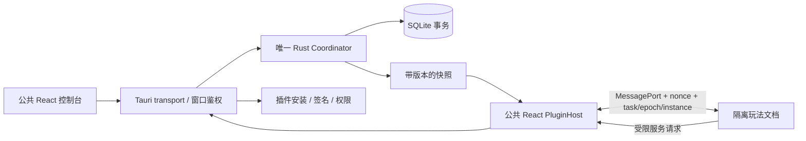

# 公共宿主与玩法插件重构实施记录

日期：2026-11-04。代码实现已落地；下表区分自动验证与仍需目标机验收的部分。依据 `report/现有代码重构方案：扩展性与开闭源隔离.md`、`report/公共服务与玩法插件架构方案.md` 实施，不修改设计报告的历史状态说明。

## 代码结构与运行链路

公共基础共 6 包，加 2 个示例玩法共 8 包。方案中的打包工具并入 SDK，插件管理并入 runtime，不再另建微服务或工具发布项目。桌面应用虽含 npm/Cargo 两份清单，仍是一套宿主。



| 包/目录 | 实施职责 |
| --- | --- |
| crates/play-core | 仅保留通用队列规则，删除旧昵称领域模型；昵称字段和规整归插件 |
| crates/play-contracts | 独立 wire 类型、版本常量、ts-rs 生成 SDK 类型，不反向依赖 Tauri/runtime |
| crates/play-runtime | 调度器、幂等回执、结果语义、StateStore、SQLite、插件验证与权限 |
| packages/plugin-sdk | 协议、生命周期客户端、独立可打包/分发的 CLI，无桌面/玩法依赖 |
| packages/desktop-ui | transport 注入、schema 表单、公共控制台、隔离 iframe 与 RPC 代理 |
| apps/desktop | 唯一 Tauri 应用、窗口鉴权、快照广播、自定义协议、数据目录单实例锁 |
| plugins/registry | 昵称登记，独立 manifest/schema/素材/入口，经正常插件机制加载 |
| plugins/workshop-2d | 二维制作，独立插件，不加入公共 UI 的 import 图 |

前端宿主仍使用 React，服务使用 Rust。插件自行携带 JS/样式/资源，不强制 React。公共仓库构建不需要私有仓库或凭据；外部玩法使用 SDK tarball/已发布确定版本独立构建。未创建任何外部仓库，也未发布 npm 包或安装包。

## 已实施行为

- 公共队列：实际按 command_id 幂等，同命令不同内容拒绝，相同昵称不同命令可再次参加。容量 100；每场至多 10000 命令回执；历史保留最近 1000 条。
- 唯一调度：Rust 先持久化再发布快照；事件丢失由轮询快照补足，不依赖单次播放事件。任务冻结插件完整版本、摘要、配置和准备输入。
- 结果：completed/failed/cancelled/interrupted 分开。结果校验 task_id/epoch/instance，旧代次、旧展示窗、重复结果不能消耗下一任务。SDK 旧回调保留旧身份。
- 恢复：展示丢失和重启记录中断；恢复后有待执行任务先暂停，运行中任务不自动重播。重试创建新任务和代次，已准备的输入复用冻结值。
- 插件：离线导入、完整性/签名/API/host range/schema/权限校验、并排安装、显式切换、回退和引用保护卸载。损坏包不进入 catalog，可在诊断中查看。
- 存储：插件仅通过当前任务访问自己的命名空间。按 id/版本/stateSchemaVersion 隔离；兼容版本显式复制到空目标并保留来源。跨 schema 迁移拒绝。
- 安全边界：iframe 仅 allow-scripts；独立受限文档 CSP 默认无网络；受限 MessagePort 握手；原生 IPC 再校验窗口身份，以及仅向可信顶层文档注入的随机请求凭证；核心权限缩小为事件监听/取消监听。不能仅依赖窗口标签区分 iframe。控制窗无权假冒展示结果，展示窗无权安装包或写发布者信任。
- 交付：两个示例与外部插件走同一入口。签名私钥不进入制品；SDK 许可随插件保留。公共自有代码与示例声明 MIT，外部专有插件自行声明许可证。

## 实施细化与设计差异

1. SQLite 使用 rusqlite（bundled），未引入原方案的 SQLx：当前唯一同步串行协调器经 StateStore 事务保存状态快照，避免为本地单用户低频队列引入异步 DB 层。WAL + synchronous FULL；存储失败不发布内存新状态。总运行时 JSON 状态限制 64 MiB。未做大规模历史查询或性能基准，后续按真实负载迁移细分表，不增加数据库服务。
2. `.lbplug` 落实为带 base64 文件、摘要、签名的 JSON 归档，未实现 ZIP 解压。安装按归档整体摘要定位，加载时再次校验。具体格式见插件开发说明。
3. schema 是受限 v1 方言，不宣称完整 JSON Schema。prepare 返回同一 schema 内的规范输入，未引入任意任务计划 DSL；progress/restore 仅预留 SDK 协议，不承诺可视进度或中途断点续播。
4. 首期入口自包含 HTML，图片/音频通过受限 data URI 解析，不开放多文件 ES modules、Worker、WASM、网络和原生插件。复杂渲染支持范围仍需目标 WebView 验证。
5. 状态升级仅实现同 stateSchemaVersion 的显式复制；跨 schema 的受限迁移协议尚未实现。卸载保留命名空间；没有自动清除客户状态的接口。
6. 不增加平台接口、支付/会员、授权服务器、在线插件市场、客户版宿主分支。平台审核许可仍属于独立接入工作，不能由本地插件架构推导其已获允许。

## 实际验证

| 验证 | 本轮结果 | 证据与范围 |
| --- | --- | --- |
| cargo test --offline | 通过 | 8 项类型生成、1 项通用规则、17 项运行时集成测试 |
| cargo clippy --offline --all-targets -- -D warnings | 通过 | 默认工作区 3 个 Rust 库及测试，不代表 GUI 依赖全平台通过 |
| pnpm test | 通过 | TypeScript、公共依赖边界、Vite 构建；私有目录独立签名包/宿主前端制品摘要不变；SDK 旧回调身份/销毁回归 |
| Linux Devbox 原生构建及动态加载 | 通过 | 2026-11-04 将原生工具链、pkg-config/OpenSSL/GTK/WebKit 等固定到 nixpkgs `8edc0c72e3a38faf5434e40d1f19431125fe4b30`；清理宿主制品后通过 `devbox run desktop:verify`。实际 ELF 加载器与 libc/libm/libmvec 均为 glibc 2.44，消除原 glibc 2.42/2.44 混用；未启动可见桌面 |
| Chromium 真实浏览器 | 通过 | 实际 React PluginHost + SDK + 假 transport，验证 opaque iframe 阻断宿主 DOM/API、CSP 阻断网络、MessagePort、暂停恢复、只完成一次 |
| Windows WebView2 / NSIS 冷安装 | 未执行 | 本环境为 Linux；CI 配置已增加 Windows 构建，但未在本会话触发或收到结果 |
| 私有插件在原生宿主安装与播放 | 部分验证 | 独立打包/签名、Rust 导入/验签与浏览器消息链分别通过；尚无 Windows 原生完整交付链实机证据 |

Chromium 测试通过不能证明 Tauri WebView2 的原生 bridge 隔离。P0 的 Windows 门槛仍未关闭，当前不可宣称生产发布已验收；也不把未运行的 CI 写为通过。

可复现命令：

```sh
pnpm install --frozen-lockfile
cargo fmt --all --check
cargo test --locked
cargo clippy --locked --all-targets -- -D warnings
pnpm test
# 安装 Chromium 后指定其可执行文件
pnpm test:browser /path/to/chromium
# 先生成示例归档，再检查原生宿主；本机需 GUI 开发依赖
pnpm plugins:build
devbox run desktop:verify
```

## Windows 发布前验收

在干净 Windows 10/11 与 WebView2 环境执行以下具体检查。任一桥接隔离检查失败，停止插件发布并改用无权限独立 WebView 重新验证，不降级为同上下文执行插件。

1. `pnpm install --frozen-lockfile && pnpm test && cargo test --locked && pnpm tauri build`；干净用户、离线场景安装 NSIS，验证离线 WebView2 安装器与中文路径。安装包已配置，尚未生成并实测。
2. 用测试插件尝试读取 parent DOM、window.__TAURI_INTERNALS__、直接调用安装/信任/结果 IPC、访问宿主自定义协议的其他包；预期拒绝。测试网络、顶层导航、窗口弹出及任意文件路径，检查 capability 与 iframe 组合。
3. 两个示例实际运行、暂停、取消、重复回执、关闭/重开展示窗、切换玩法、应用重启和休眠。验证事件丢失不丢任务，旧回调不结束新任务，重启不会自动重播。
4. 在独立私有仓库仅安装 SDK，签名构建插件；固定公共 exe/安装包摘要，信任公钥后导入并播放，确认不用更改公共宿主。覆盖不信任、错误签名、路径穿越与不兼容 API。
5. 测试相同 ID 多版本并排、兼容状态复制、已有状态覆盖拒绝、跨 schema 拒绝、回退、任务引用时拒绝卸载。确认数据目录、错误反馈和损坏包诊断。

开发操作见 [插件开发](plugin-development.md)，入口见 [README](../README.md)。设计基线仍在 report；本记录说明代码状态，供后续平台验收使用。
